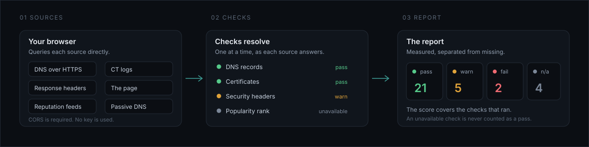

<div align="center">


**[ocellus.zynu.me](https://ocellus.zynu.me)** &nbsp;·&nbsp; [Checks](https://ocellus.zynu.me/checks/) &nbsp;·&nbsp; [Method](https://ocellus.zynu.me/method/)

<a href="https://github.com/izynu/ocellus/blob/main/LICENSE"></a>


</div>

---

Ocellus reads a website the way a careful visitor would: it asks the domain what it publishes, asks the certificate logs what was issued, asks the server what it admits in its headers, and reads the page to see how it is built and what it loads. Then it shows the answer, the evidence behind the answer, and what it could not determine.

It runs entirely in your browser. There is no server, no account, no API key, and no database. Every value in a report came from a public source that your browser queried directly.



## What it checks

Each check answers a single question and reports what it measured. They are grouped by what they look at.

| Group | What it determines |
| --- | --- |
| **Transport and certificates** | What certificates have been issued for the domain, by which authorities, for which hostnames, how long they last, and which of them were revoked |
| **Name system** | Every address, mail, name-server and text record the zone publishes, when the registration began and expires, whether a wildcard answers for names nobody registered, and whether DNSSEC is in place |
| **Response headers** | Whether the server sends the headers that tell a browser how to behave, how strong each one is, and which CDN, proxy or web application firewall answered in front of the origin |
| **Email** | Whether SPF, DKIM and DMARC exist and whether they actually prevent forgery |
| **Infrastructure** | Where the site is hosted, who announces the address, what Shodan has observed listening on it, and whether the software it names appears in the catalogue of vulnerabilities known to be exploited |
| **Privacy** | Which cookies are set before consent, which trackers load, and what third parties the page contacts |
| **Content and accessibility** | Heading structure, alt text, form labels, duplicate ids, tab order, and the language declaration |
| **Performance** | Render-blocking resources, compression, caching, image dimensions and DOM size |
| **Search and preview** | Crawl directives, canonical, sitemap, and whether a shared link renders as a card |
| **Reputation** | Whether the domain appears in threat intelligence, whether a filtering resolver refuses to resolve it, how widely it is seen in traffic, whether the operator has been breached, and whether it is marked as a false positive |
| **Interface friction** | Pre-checked consent boxes, confirmshaming copy, forced actions, and scarcity pressure |

A check that cannot run is reported as **unavailable** with the reason. It is removed from the score's denominator rather than counted as a pass. A site that blocks the scanner does not get a good grade for it.

## How the score works

Every check carries a weight according to what it protects. Context checks carry the least, material checks more, and structural checks the most. Each status earns part of that weight: a pass earns all of it, an info or a warning earns most of it, and a fail keeps only a little. The score is the weighted mean over the checks that actually ran.

Grades follow the score: **A** at 90 or above, **B** at 78, **C** at 64, **D** at 50, **E** at 32, and **F** below 32. The [method page](https://ocellus.zynu.me/method/) sets out the arithmetic in full.

## Where the data comes from

No source requires a key, and each is queried from the visitor's browser.

| Source | Used for |
| --- | --- |
| Google Public DNS and Cloudflare over DNS-over-HTTPS | Every DNS record, including DNSSEC |
| Cloudflare's security resolver | Whether a filtering resolver refuses to resolve the domain |
| [crt.sh](https://crt.sh) Certificate Transparency index | Issued certificates and the subdomain surface |
| [Cert Spotter](https://sslmate.com/certspotter/) | A second certificate index, and which certificates were revoked |
| [rdap.org](https://rdap.org) | Registration date, expiry, registrar and registry status |
| [archive.org](https://web.archive.org) | How long the address has been captured in public |
| [Tranco](https://tranco-list.eu) | Where the domain sits in a public traffic ranking |
| [Shodan InternetDB](https://internetdb.shodan.io) | Open ports and known CVEs for the resolved address |
| [ipwho.is](https://ipwho.is) | Geolocation and autonomous system |
| [AlienVault OTX](https://otx.alienvault.com) | Threat intelligence pulses |
| [Have I Been Pwned](https://haveibeenpwned.com) | Whether the operator has appeared in a disclosed breach |
| [CISA KEV](https://www.cisa.gov/known-exploited-vulnerabilities-catalog) and [FIRST EPSS](https://www.first.org/epss/) | Whether the software the server names is known to be exploited, and how likely |
| [api.hackertarget.com](https://api.hackertarget.com) | Raw response headers and the redirect chain |
| [r.jina.ai](https://r.jina.ai) | The document itself, because most sites send no CORS header |

## Using it

Open [ocellus.zynu.me](https://ocellus.zynu.me), type a domain or a full address, and start the scan. There is nothing to install and nothing to sign in to.

The checks resolve one at a time, so you watch each result arrive rather than waiting on a spinner. When the report appears, every check is listed in report order with its status, the value it measured, and the evidence behind it. Checks that could not run are kept in the list, marked unavailable, with the reason.

You can link straight to a scan with `?url=` in the address, print the report, or download it as JSON. Nothing is stored beyond your own browser tab.

## Run it locally

```bash
git clone https://github.com/izynu/ocellus.git
cd ocellus
npm install
npm run dev
```

Open `http://localhost:3000`. No environment variables are needed for local development.

## Limits

It does not render the page, so it cannot measure contrast ratios or Core Web Vitals timings. It does not execute JavaScript, so it cannot see behaviour that only happens on interaction. It does not test for exploits, does not authenticate, and does not crawl beyond the URL you give it. A clean report is not a security assessment.

These limits are stated on the [method page](https://ocellus.zynu.me/method/) and inside the report itself, because a tool that hides them is worse than one that has them.

## Licence

MIT. See [LICENSE](LICENSE).

<div align="center">
<sub>Built and maintained by <a href="https://zynu.me">Zynu</a>.</sub>
</div>
