<div align="center">



**[ocellus.zynu.me](https://ocellus.zynu.me)** &nbsp;·&nbsp; [Checks](https://ocellus.zynu.me/checks/) &nbsp;·&nbsp; [Method](https://ocellus.zynu.me/method/)

</div>

---

Ocellus reads a website the way a careful visitor would: it asks the domain what it publishes, asks the certificate logs what was issued, asks the server what it admits in its headers, and reads the page to see how it is built and what it loads. Then it shows the answer, the evidence behind the answer, and what it could not determine.

It runs entirely in your browser. There is no server, no account, no API key, and no database. Every value in a report came from a public source that your browser queried directly.

## What it checks

Sixteen checks across eleven groups. Each one answers a single question and reports what it measured.

| Group | What it determines |
| --- | --- |
| **Transport and certificates** | What certificates have been issued for the domain, by which authorities, for which hostnames, and how long they last |
| **Name system** | Every address, mail, name-server and text record the zone publishes, and whether DNSSEC is in place |
| **Response headers** | Whether the server sends the headers that tell a browser how to behave, and how strong each one is |
| **Email** | Whether SPF, DKIM and DMARC exist and whether they actually prevent forgery |
| **Infrastructure** | Where the site is hosted, who announces the address, and what Shodan has observed listening on it |
| **Privacy** | Which cookies are set before consent, which trackers load, and what third parties the page contacts |
| **Content and accessibility** | Heading structure, alt text, form labels, duplicate ids, tab order, and the language declaration |
| **Performance** | Render-blocking resources, compression, caching, image dimensions and DOM size |
| **Search and preview** | Crawl directives, canonical, sitemap, and whether a shared link renders as a card |
| **Reputation** | Whether the domain appears in threat intelligence, and whether it is marked as a false positive |
| **Interface friction** | Pre-checked consent boxes, confirmshaming copy, forced actions, and scarcity pressure |

A check that cannot run is reported as **unavailable** with the reason. It is removed from the score's denominator rather than counted as a pass. A site that blocks the scanner does not get a good grade for it.

## How the score works

Every check carries a weight. `1` is context, `2` is material, `3` is structural. Each status earns a fixed fraction of that weight:

| Status | Fraction |
| --- | --- |
| pass | 1.00 |
| info | 0.85 |
| warn | 0.55 |
| fail | 0.10 |
| unavailable | excluded |

The score is the weighted mean over the checks that ran, and the grade bands are A 90+, B 78+, C 64+, D 50+, E 32+, F below 32. The arithmetic is in [`src/lib/scan/score.ts`](src/lib/scan/score.ts) and is reproduced on the [method page](https://ocellus.zynu.me/method/).

## Where the data comes from

No source requires a key, and each is queried from the visitor's browser.

| Source | Used for |
| --- | --- |
| Google Public DNS and Cloudflare over DNS-over-HTTPS | Every DNS record, including DNSSEC |
| [crt.sh](https://crt.sh) Certificate Transparency index | Issued certificates and the subdomain surface |
| [Shodan InternetDB](https://internetdb.shodan.io) | Open ports and known CVEs for the resolved address |
| [ipwho.is](https://ipwho.is) | Geolocation and autonomous system |
| [AlienVault OTX](https://otx.alienvault.com) | Threat intelligence pulses |
| [api.hackertarget.com](https://api.hackertarget.com) | Raw response headers and the redirect chain |
| [r.jina.ai](https://r.jina.ai) | The document itself, because most sites send no CORS header |

## Running it

```bash
git clone https://github.com/izynu/ocellus.git
cd ocellus
npm install
npm run dev
```

Open `http://localhost:3000`. No environment variables are needed for local development.

## Building for deployment

One source tree produces two deployables. The only difference is the base path.

```bash
# Shared cPanel hosting: upload dist/cpanel/ to public_html
NEXT_PUBLIC_SITE_URL=https://yourdomain.tld npm run build:cpanel

# GitHub Pages: built and published by the workflow on push to main
npm run build:pages
```

| Target | Output | Base path | Notes |
| --- | --- | --- | --- |
| cPanel | `dist/cpanel/` | none | Includes an `.htaccess` with HTTPS redirect, security headers, compression and cache policy |
| GitHub Pages | `dist/pages/` | `/<repo>` | Includes `.nojekyll`, deployed by the workflow in `.github/workflows/deploy.yml` |

The cPanel build is a plain directory of static files. Upload the contents of `dist/cpanel/` into `public_html` with the file manager or over FTP. The `.htaccess` is generated from the template in [`scripts/build.mjs`](scripts/build.mjs) and sets the same header policy the scanner grades, so the site passes its own check.

For the full procedure, including domain setup, AutoSSL, the Apache modules the site needs and what each failure mode looks like, open [`docs/cpanel-deploy.html`](docs/cpanel-deploy.html) in a browser.

## Project layout

```
src/
  app/            routes, one directory per page
  components/
    scan/         the scanning interface and the report renderer
    site/         header, footer, theme toggle, background scene
  lib/
    checks/       one module per check, plus the registry
    net/          fetch layer, DNS-over-HTTPS resolver, document reader
    scan/         runner and scoring
scripts/
  build.mjs       produces both deployables
```

Adding a check means writing one module that exports a `CheckDefinition` and adding it to [`src/lib/checks/index.ts`](src/lib/checks/index.ts). The scan page, the catalogue, the report order and the sitemap all read from that registry, so nothing else needs editing.

## What it does not do

It does not render the page, so it cannot measure contrast ratios or Core Web Vitals timings. It does not execute JavaScript, so it cannot see behaviour that only happens on interaction. It does not test for exploits, does not authenticate, and does not crawl beyond the URL you give it. A clean report is not a security assessment.

These limits are stated on the [method page](https://ocellus.zynu.me/method/) and inside the report itself, because a tool that hides them is worse than one that has them.

## Licence

See [LICENSE](LICENSE).

<div align="center">
<sub>Built and maintained by <a href="https://zynu.me">Zynu</a>.</sub>
</div>
