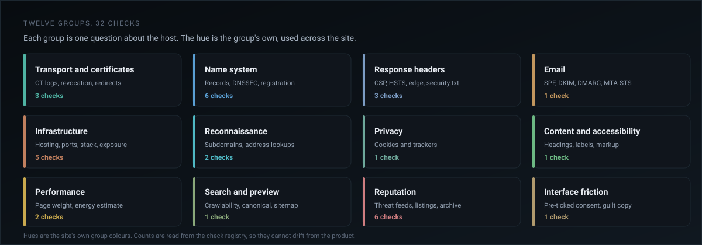

<div align="center">


### [Open Ocellus](https://izynu.github.io/ocellus/) &nbsp;|&nbsp; [Scan](https://izynu.github.io/ocellus/scan/) &nbsp;|&nbsp; [Checks](https://izynu.github.io/ocellus/checks/) &nbsp;|&nbsp; [Sources](https://izynu.github.io/ocellus/sources/) &nbsp;|&nbsp; [Dorks](https://izynu.github.io/ocellus/dorks/) &nbsp;|&nbsp; [Method](https://izynu.github.io/ocellus/method/)

<a href="https://github.com/izynu/ocellus/blob/main/LICENSE"></a>


</div>

Ocellus is a website audit and reconnaissance console that runs entirely in the visitor's browser. You type a hostname, and 34 fixed checks read it from the outside with the tools a careful analyst would use: the DNS zone, the certificate logs, the response headers, the mail policy records, the public reputation feeds, the page markup, the trackers it loads, and the software it names. Each check answers one question, and the report shows the measured value, the source that supplied it, and the status. It refuses to invent: a value is either what a named public source returned, or an explicit statement that the source could not be reached. There is no backend, no account, no API key, and no database, and a check that cannot run is removed from the score rather than counted as a pass.


<details>
<summary><b>Contents</b></summary>

- [Features, by group](#features-by-group)
- [Every category, at a glance](#every-category-at-a-glance)
- [Source coverage](#source-coverage)
- [Recon workflow](#recon-workflow)
- [Dorks](#dorks)
- [Scoring](#scoring)
- [PDF and JSON export](#pdf-and-json-export)
- [Using it](#using-it)
- [Run it locally](#run-it-locally)
- [Deploy](#deploy)
- [Keywords](#keywords)
- [What it does not do](#what-it-does-not-do)
- [Licence](#licence)

</details>

---

## Six working tools

The product is organised by what you can do, and every tool below runs in the browser.

| Tool | What it does | Where |
| --- | --- | --- |
| **Site scan** | 34 checks across 12 categories against one hostname, results streaming in as each source answers | [`/scan`](https://izynu.github.io/ocellus/scan/) |
| **URL and file scanner** | A live verdict from Google Safe Browsing and OpenPhish, the page it returns, and a local SHA-256 hash lookup so a file is never uploaded | [`/url-scan`](https://izynu.github.io/ocellus/url-scan/) |
| **Ports and Nmap** | A full staged sweep of every public index in nmapAutomator's order, plus the exact nmap and nmapAutomator command per stage | [`/ports`](https://izynu.github.io/ocellus/ports/) |
| **Recon workflow** | The eight-phase sequence, each phase linking to the tool that carries it out | [`/recon`](https://izynu.github.io/ocellus/recon/) |
| **Dork generator** | 82 queries across Google, Bing, DuckDuckGo, Shodan, GitHub and Censys, filled in for your domain | [`/dorks`](https://izynu.github.io/ocellus/dorks/) |
| **Source catalogue** | 120 indexes, APIs and scanners, each stating why a browser can or cannot reach it | [`/sources`](https://izynu.github.io/ocellus/sources/) |

### What the sweep can and cannot do

A browser cannot send a SYN packet, so no page can port-scan. The `/ports` tool does the honest equivalent: it runs the same seven stages nmapAutomator runs, against the public indexes that recorded what an active scan would have found, and reports each stage with a real answer or a real gap. Then it writes the nmap command that does the stage for real on your own machine.

| Stage | Runs in the page | The command it gives you |
| --- | --- | --- |
| Resolve | DNS over HTTPS | `nmap -sn` |
| Name service | NS records | `dig NS` |
| Ownership | RIPEstat, registry | `whois` |
| Observed ports | Shodan InternetDB | `nmap -sS --top-ports 1000` |
| Services | CPE and CVE ids | `nmap -sV -sC -p-` |
| Reverse name | PTR records | `dig -x` |
| HTTP | Header proxy | `nmap --script http-*` |

### Bring your own keys

Four sources need a key and a static page cannot ship one. The scan has a key panel: paste your own Shodan, Censys, urlscan or VirusTotal key, and it is stored in that browser only, sent only to the service it belongs to, and never written into a report. Shodan, Censys and urlscan then run as real checks. VirusTotal is listed with the truth: its API sends no cross-origin header, so a page cannot read it even with a valid key, and the check says so instead of pretending.

---

## Features, by group

A scan runs **34 fixed checks across 12 groups**. The groups are ordered from the transport and name layer outward to the page and its reputation. Every title below is the real check title read from the registry in [`src/lib/checks/index.ts`](src/lib/checks/index.ts), so this list cannot drift from the product.

### Transport and certificates
What was issued for the name, whether it is still trusted, and every hop the request takes.

- Certificate transparency
- Certificate revocation
- Redirect chain

### Name system
What the zone publishes, who owns the registration, and whether the name layer is signed and hygienic.

- DNS records
- DNSSEC
- Domain registration
- Zone hygiene
- Aliases and service records
- Nameserver delegation

### Response headers
Whether the server tells a browser how to protect the visitor, and what sits in front of the origin.

- HTTP security headers
- Edge protection
- security.txt

### Email
Whether the domain's mail can be authenticated, or anyone can forge it.

- Email authentication

### Infrastructure
Where the site is hosted, what else shares the address, and whether the software it names is known to be exploited.

- Hosting and exposure
- Co-hosted domains
- Exploited vulnerabilities
- Subdomain surface
- Technology stack

### Reconnaissance
The passive half of a recon workflow: what can be learned without touching the target.

- Subdomain enumeration
- URL and address lookups

### Privacy
What the page sets and loads before the visitor agrees to anything.

- Cookies and trackers

### Content and accessibility
Whether the document is structured for people and assistive technology.

- Markup and accessibility

### Performance
What the browser must download before it can paint, and the energy cost of one view.

- Page weight and loading
- Energy estimate

### Search and preview
Whether search engines can crawl, index and correctly preview the site.

- SEO and crawlability

### Reputation
What public feeds and history say about the domain, separated from what they could not confirm.

- Threat reputation
- Malware and phishing listings
- Filtering resolvers
- Operator breach history
- Archive history
- Popularity rank

### Interface friction
Whether the page uses manipulative interface patterns against the visitor.

- Interface friction

---

## Every category, at a glance



| Group | Checks | What it determines |
| --- | :--: | --- |
| **Transport and certificates** | 3 | Which certificates were issued, by whom, for which names, which were revoked, and every redirect hop |
| **Name system** | 6 | Every record the zone publishes, the registration window, DNSSEC, wildcard answers, aliases, and nameserver networks |
| **Response headers** | 3 | Which protective headers are set and how strong they are, what CDN or WAF answered, and whether a security contact is published |
| **Email** | 1 | Whether SPF, DKIM and DMARC exist and actually prevent forgery, and whether MTA-STS is announced |
| **Infrastructure** | 5 | Where the site is hosted, what Shodan recorded listening, which hosts share the address, and whether named software is in the exploited-vulnerability catalogue |
| **Reconnaissance** | 2 | Which hostnames passive DNS recorded, the reverse name and address owner, and what a public URL scanner captured |
| **Privacy** | 1 | Cookies set before consent, trackers loaded, and third parties the page contacts |
| **Content and accessibility** | 1 | Headings, alt text, form labels, duplicate ids, tab order, and the language declaration |
| **Performance** | 2 | Render-blocking resources, compression, caching, image dimensions, DOM size, and an energy estimate per view |
| **Search and preview** | 1 | Crawl directives, canonical, sitemap, and whether a shared link renders as a card |
| **Reputation** | 6 | Threat intelligence, current malware and phishing listings, filtering resolvers, operator breaches, archive age, and traffic rank |
| **Interface friction** | 1 | Pre-ticked consent, confirmshaming copy, forced actions, and scarcity pressure |

---

## Source coverage

The catalogue in [`src/lib/recon/sources.ts`](src/lib/recon/sources.ts) lists every index, API and scanner a person might expect, and states for each whether a check actually queries it from a page. Counts are read from that module.

| | Count |
| --- | :--: |
| Catalogued sources | 120 |
| Answered natively in the browser | 26 |
| Reference only (listed, with the reason) | 94 |

The 120 rows break down by the exact barrier that stops a static page:

| Barrier | Rows |
| --- | :--: |
| Needs an API key | 38 |
| Web interface only | 34 |
| CORS open | 31 |
| Needs a raw socket | 12 |
| Sends no CORS header, read via a reader proxy | 3 |
| Paid plan | 2 |

The 26 native rows are the **23 CORS-open** and **3 reader-proxied** entries; every other barrier is reference only. The honest summary: **API-key and raw-socket sources cannot run in a page at all.** A key the visitor does not hold, and a socket a page cannot open, are hard limits, not configuration. Those rows link to where you can use the service by hand. Every row in the catalogue, with its barrier and the check that answers it, is on the [sources page](https://izynu.github.io/ocellus/sources/).

---

## Recon workflow

The [recon page](https://izynu.github.io/ocellus/recon/) follows the eight-phase workflow the bug-bounty community has converged on, from [`src/lib/recon/methodology.ts`](src/lib/recon/methodology.ts). Six phases run in the browser; two need a terminal, and the page names the tool for each rather than pretending to run it.

| Phase | Runs in browser | Checks | Terminal tools named |
| --- | :--: | --- | --- |
| Address space and networks | yes | Hosting and exposure, Nameserver delegation, Co-hosted domains | whois, bgp.he.net, RIPEstat |
| Subdomain enumeration | yes | Subdomain enumeration | crt.sh, subfinder, amass, assetfinder, dnsx |
| Fingerprinting | yes | Technology stack, Edge protection, HTTP security headers, Exploited vulnerabilities | httpx, wappalyzer, CISA KEV |
| Search-engine discovery | yes (generates, does not run) | none | Google dorks, Bing, DuckDuckGo |
| Content and parameter discovery | no | none | ffuf, feroxbuster, gobuster, dirsearch, arjun |
| Ports and services | no (reads Shodan's index only) | Hosting and exposure | nmap, naabu, masscan, Shodan InternetDB |
| Certificates and transport | yes | Certificate transparency, Certificate revocation, Redirect chain | crt.sh, Cert Spotter, SSL Labs, testssl.sh |
| Reputation and history | yes | Threat reputation, Malware and phishing listings, Filtering resolvers, Operator breach history, Archive history, Popularity rank | VirusTotal, URLhaus, OpenPhish, Wayback Machine, Have I Been Pwned |

A page can query public indexes that send CORS headers, and nothing else. It cannot open a DNS socket, send a SYN, or run a binary, so the two terminal phases are labelled as terminal.

---

## Dorks

A dork is a search-engine query built from operators (`site:`, `inurl:`, `ext:`, `intitle:`) rather than words. It surfaces files, admin panels and debug output a site published by accident but which the engine has indexed.

The [dorks page](https://izynu.github.io/ocellus/dorks/) holds **82 templates across ten categories**:

- **Exposed files and documents** (9): `.env` files, backups, configs, office documents, directory listings, logs.
- **Secrets and pastes** (8): paste sites, credentials in text, committed configs.
- **Object storage and cloud** (9): buckets, CDN origins and hosted data that name the domain.
- **Interfaces and API surface** (8): specs, consoles and endpoints the site publishes.
- **Sign-in and admin surfaces** (7): login pages, admin panels, staging hosts, database tools, API docs.
- **Errors and debug output** (6): stack traces, framework debug panels, verbose error pages.
- **Code and repositories** (9): repositories, configuration and pipeline files that mention the domain.
- **Documents and published pages** (9): PDFs, wikis, spreadsheets and runbooks published outside the main site.
- **Indexable content** (9): indexed pages, pages marked internal, old paths, cached copies.
- **Infrastructure and third parties** (8): sibling hostnames, brand mentions, shared-name hosts, DNS archives.

Ocellus **generates** a dork for your target and opens it in your own browser against the engine's own index. It **never runs** one itself: every engine's terms forbid automated querying without an API key, and a report that claimed to have run one would describe a request nobody made.

---

## Scoring

The rules are fixed and published, coded in [`src/lib/scan/score.ts`](src/lib/scan/score.ts). Every check carries a weight of 1, 2 or 3. Each status maps to a fixed fraction of that weight:

| Status | Fraction of weight | Meaning |
| --- | :--: | --- |
| `pass` | 1.00 | The source answered and the rule was met |
| `info` | 0.85 | An observation, not a judgement |
| `warn` | 0.55 | Worth fixing, not severe alone |
| `fail` | 0.10 | The rule was broken |
| `unavailable` | removed | The source could not be reached, so no verdict is claimed |
| `skipped` | removed | The check does not apply to this target |

The score is the weighted mean over the checks that returned a verdict, rounded to a whole number. Grade bands:

| Grade | Score |
| --- | :--: |
| A | 90 or above |
| B | 78 to 89 |
| C | 64 to 77 |
| D | 50 to 63 |
| E | 32 to 49 |
| F | below 32 |

There are no curves, no per-site adjustments and no hidden bonuses. A site with twelve unavailable checks and four passes is scored on four checks, and the report says so.

---

## PDF and JSON export

Every report has two exports:

- **Export PDF** opens the browser's print dialog. Choose Save as PDF there. The report has a dedicated print layout, so the paper copy keeps the grouping, the evidence lines and the status of every check.
- **Export JSON** downloads the full report object as `ocellus-<host>-<date>.json`. It carries the report schema version (currently `1.1`), every check result, every finding, and the list of sources that answered.

Both are produced in your browser. The JSON is built with `Blob` from the in-memory report; nothing is uploaded.

---

## Using it

1. Open [izynu.github.io/ocellus/](https://izynu.github.io/ocellus/).
2. Type a hostname (`example.com`) or a full address (`https://example.com/path`).
3. Start the scan. Checks resolve one at a time as each source answers, so you watch results land rather than wait on a spinner.

You get the full report in report order, each check with its status, the value it measured, and the evidence. Checks that could not run stay in the list, marked unavailable, with the reason. You can link straight to a scan with `?url=` in the address, print it, or download the JSON. Nothing is stored beyond your own browser tab.

---

## Run it locally

Requires Node.js 22, the version the deployment workflow uses.

```bash
git clone https://github.com/izynu/ocellus.git
cd ocellus
npm install
npm run dev
```

Open `http://localhost:3000`. No environment variables are needed for local development. Scripts, read from [`package.json`](package.json):

| Script | What it does |
| --- | --- |
| `npm run dev` | Start the development server |
| `npm run build` | Build the GitHub Pages target into `dist/pages/` |
| `npm run start` | Serve the built `dist/pages/` directory |
| `npm run lint` | Run ESLint over the tree |
| `npm run typecheck` | Run the TypeScript compiler with no emit |

`npm run dev` serves the site at the origin root, so local URLs carry no `/ocellus` prefix. Only a production build bakes that prefix in.

---

## Deploy

Ocellus deploys to GitHub Pages, and only to GitHub Pages. The live workflow is [`.github/workflows/deploy.yml`](.github/workflows/deploy.yml), which builds on every push to `main`.

How it runs:

1. Checks out, installs Node 22, runs `npm ci --ignore-scripts`.
2. Runs `npx tsc --noEmit` as a type gate.
3. Runs `node scripts/build.mjs pages`, which runs the Next static export and copies it to `dist/pages/`, writes `.nojekyll` so the `_next/` directory is served, and writes a `CNAME` file when a custom domain is set.
4. Uploads `dist/pages/` with `upload-pages-artifact` and deploys it with `deploy-pages`.

The `basePath` is the part that has to be right. GitHub Pages serves a project site from `/<repo>/`, so every asset URL needs that prefix baked in at build time. Next can only apply `basePath` during the build, which is why the Pages build sets `OC_PAGES_BASE` (default `/<repo>`) and the workflow passes the repository name.

Repository variables the workflow reads:

| Variable | Effect |
| --- | --- |
| `SITE_URL` | The canonical origin. Defaults to `https://<owner>.github.io`. |
| `CUSTOM_DOMAIN` | When set, `build.mjs` writes it as the `CNAME` file and Pages serves the custom domain. It also turns the base path off, because a custom domain serves from the origin root. |
| `PAGES_BASE` | Optional base path override. Defaults to `/<repo>`, and is ignored when `CUSTOM_DOMAIN` is set. |

A custom domain is wired but **not yet claimed**: no `CNAME` is written today because `CUSTOM_DOMAIN` is unset, so [izynu.github.io/ocellus](https://izynu.github.io/ocellus/) is the canonical host. Set `SITE_URL` to the domain and `CUSTOM_DOMAIN` to the same host, point DNS at Pages, then push; the workflow drops the `/ocellus` prefix automatically. `build.mjs` refuses to build with an empty prefix and no domain, because that combination deploys a site whose own assets 404.

---

## Keywords

Website audit, website security scanner, website reconnaissance, recon tool, OSINT tool, security headers checker, HTTP header scanner, Content-Security-Policy, CSP, HSTS, security.txt, DNS lookup, DNS records, DNSSEC checker, CAA record, MX record checker, SPF checker, DKIM checker, DMARC checker, MTA-STS, email authentication, email spoofing, certificate transparency, CT logs, certificate revocation, subdomain enumeration, subdomain finder, passive DNS, reverse DNS, reverse IP lookup, whois lookup, RDAP lookup, domain age, domain expiry, IP geolocation, ASN lookup, BGP lookup, open ports, Shodan, Censys, attack surface, URL scanner, malware scanner, phishing check, VirusTotal, Google Safe Browsing, URLhaus, OpenPhish, threat intelligence, AlienVault OTX, blocklist check, spam blocklist, domain reputation, IP reputation, CISA KEV, EPSS, CVE exposure, technology fingerprint, tech stack detector, Wappalyzer, WhatWeb, web archive, Wayback Machine, Google dorks, dork generator, google hacking, shodan dorks, privacy report, tracker detection, cookie audit, consent dark patterns, accessibility audit, WCAG checker, SEO audit, robots.txt checker, sitemap checker, page weight, carbon footprint website, Nuclei, nmap, subfinder, amass, httpx, katana, OWASP, penetration testing recon, bug bounty recon, static site scanner, browser only scanner, no API key scanner, client side security scanner, header scanner, TLS certificate checker, redirect chain, zone transfer check, wildcard DNS, nameserver delegation, hosting lookup, WAF detection, CDN detection, CMS detector, security misconfiguration, cookie consent audit, offsite link audit, energy estimate, website carbon, HTTP/2 checker, mixed content checker, social preview card, canonical URL checker, hreflang check, open graph preview, site audit tool, web security audit, website health check, passive reconnaissance, external attack surface, domain intelligence, browser based scanner, keyless scanner, self-hosted recon console, client-side security testing.

---

## What it does not do

A clean report is not a security assessment, and the report says so. Specifically:

- **It does not render the page.** There is no layout engine and no script execution, so it cannot compute contrast ratios, measure Core Web Vitals timings, or observe what a page does after load.
- **It does not test for exploits.** A finding describes a configuration or a missing control, not a working attack.
- **It does not log in, submit a form, or crawl.** One document is fetched, not a site.
- **It does not run active scans.** No port scan, no fuzzing, no brute force. The port list comes from a third-party index that observed the address at some earlier time.
- **It does not run dorks.** It generates them and hands them to your browser.
- **It does not query keyed or socket-only sources.** Those are catalogued with the exact barrier, not imitated.
- **It does not decide whether a site is secure.** It reports what public sources say about one hostname at one moment, and shows where each value came from.

These limits are stated on the [method page](https://izynu.github.io/ocellus/method/) and inside the report itself.

---

## Licence

MIT. See [LICENSE](LICENSE).

<div align="center">
<sub>Built and maintained by <a href="https://zynu.me">Zynu</a>. The checks, the source catalogue and the honesty rules live in <code>src/lib</code>.</sub>
</div>
